<p align="center">
  
</p>

# LSX4

LSX4 is an open-source PlayStation 4 emulator application for Android.

Development also makes use of current-generation large language models (LLMs).

LSX4 does not include games, firmware, or other copyrighted system content.

## Playable games

<table>
  <tr>
    <td align="center" width="50%">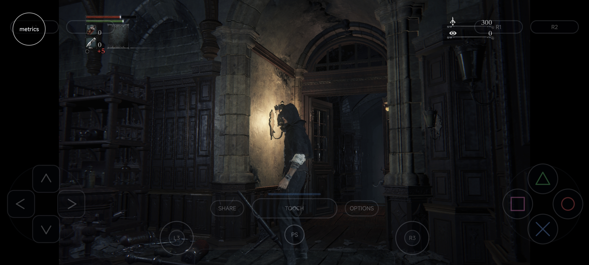<br><sub><b>Bloodborne</b></sub></td>
    <td align="center" width="50%">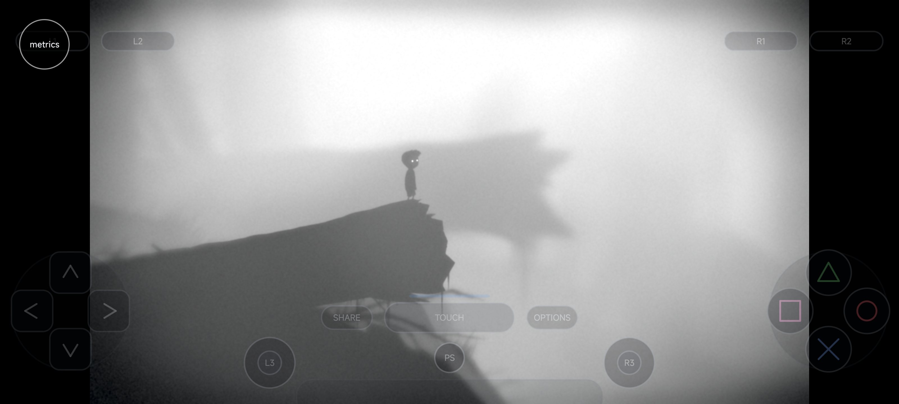<br><sub><b>Limbo</b></sub></td>
  </tr>
  <tr>
    <td align="center" width="50%">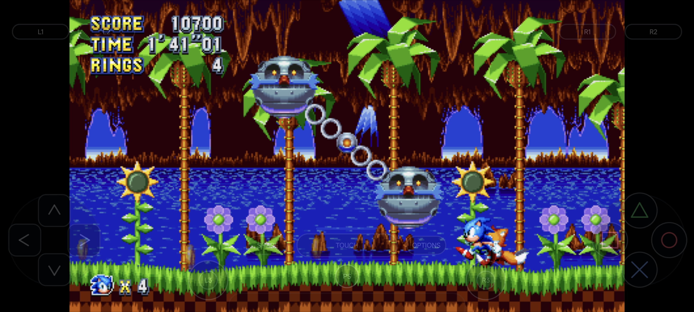<br><sub><b>Sonic Mania</b></sub></td>
    <td align="center" width="50%">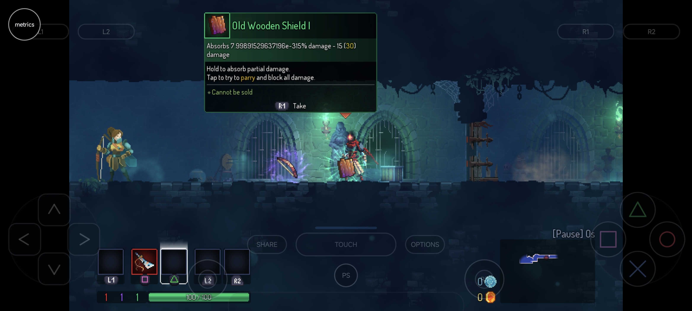<br><sub><b>Hyper Light Drifter</b></sub></td>
  </tr>
  <tr>
    <td align="center" width="50%">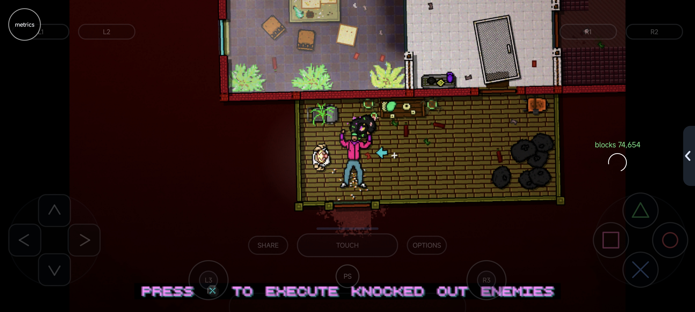<br><sub><b>Hotline Miami 2: Wrong Number</b></sub></td>
    <td align="center" width="50%">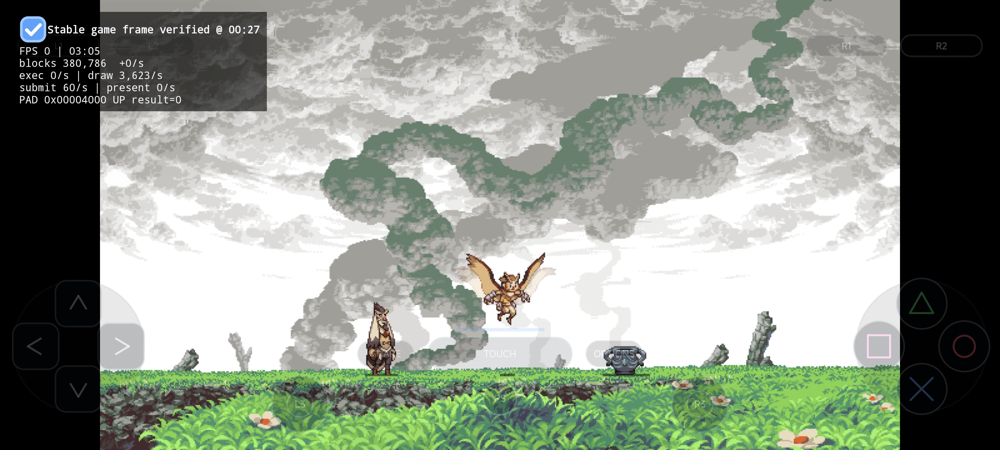<br><sub><b>Owlboy</b></sub></td>
  </tr>
  <tr>
    <td align="center" width="50%">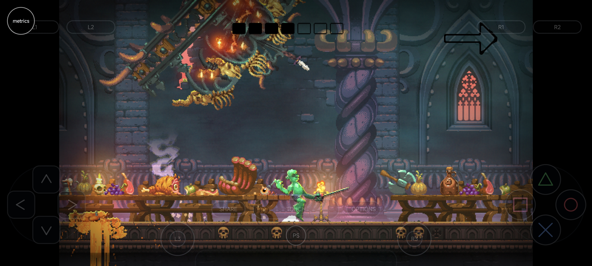<br><sub><b>Shovel Knight</b></sub></td>
    <td align="center" width="50%">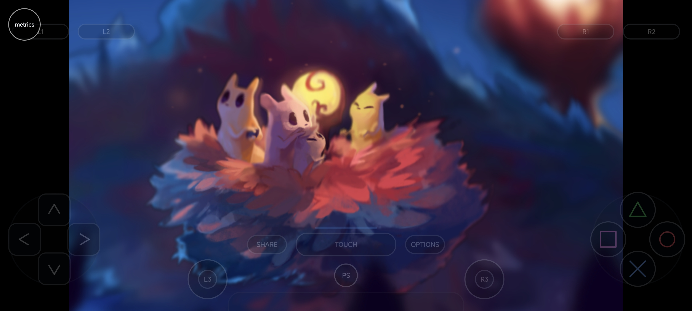<br><sub><b>Rain World</b></sub></td>
  </tr>
  <tr>
    <td align="center" width="50%">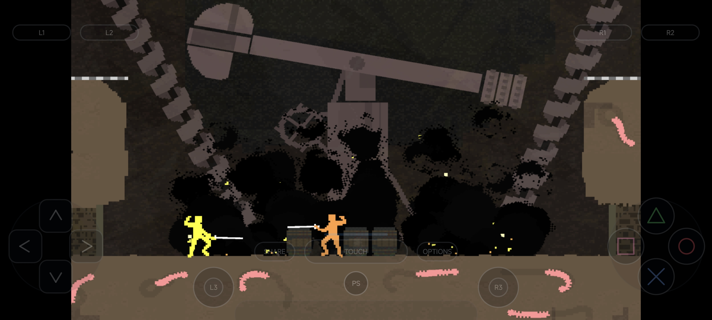<br><sub><b>Nidhogg 2</b></sub></td>
    <td align="center" width="50%">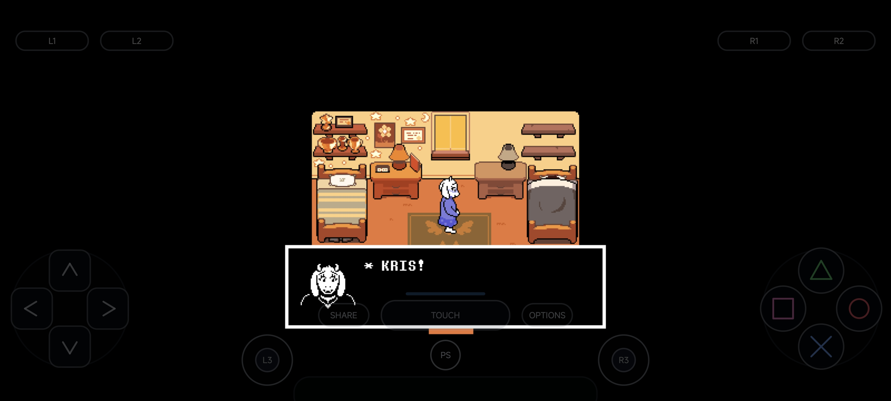<br><sub><b>Deltarune Chapters 1 &amp; 2</b></sub></td>
  </tr>
  <tr>
    <td align="center" width="50%">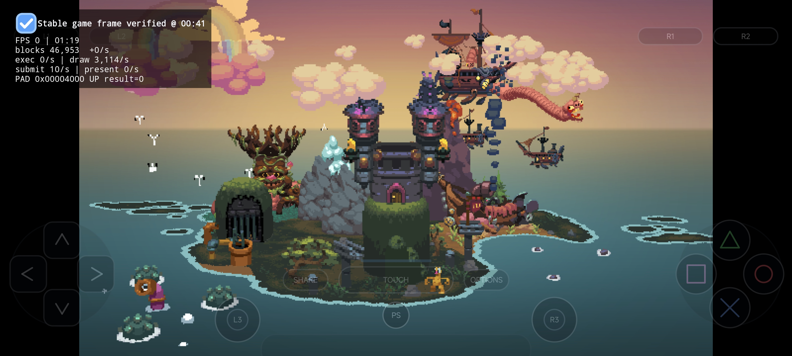<br><sub><b>Just Shapes &amp; Beats</b></sub></td>
    <td align="center" width="50%">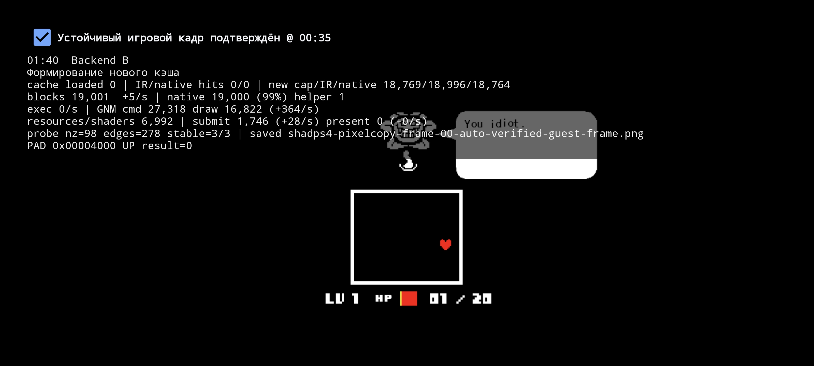<br><sub><b>Undertale</b></sub></td>
  </tr>
  <tr>
    <td align="center" colspan="2">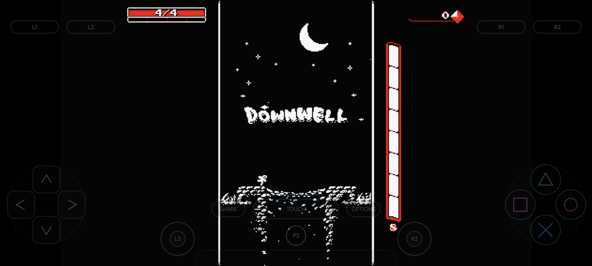<br><sub><b>Downwell</b></sub></td>
  </tr>
</table>

This list includes only games that have been tested. The broader set of supported games is larger and still requires testing.

| Game | Playable | Notes |
| --- | :---: | --- |
| Bloodborne | ✅ | Gameplay is temporarily limited to 7 FPS. |
| Deltarune Chapters 1 & 2 | ✅ | |
| Downwell | ✅ | |
| Hotline Miami 2: Wrong Number | ✅ | |
| Hyper Light Drifter | ✅ | |
| Just Shapes & Beats | ✅ | |
| Limbo | ✅ | |
| Minit | ✅ | |
| Nidhogg | ✅ | |
| Nidhogg 2 | ✅ | |
| Owlboy | ✅ | |
| Rain World | ✅ | |
| Shovel Knight | ✅ | |
| Sonic Mania | ✅ | |
| Undertale | ✅ | |

## Repository layout

| Path | Purpose |
| --- | --- |
| `android-app/` | LSX4 Android application |
| `src/` | Native runtime, translation, system, and graphics sources |
| `externals/` | Native build dependencies |
| `cmake/` | Android native build support |
| `scripts/` | Android dependency build helpers |
| `funnel-arm/` | ARM adaptation foundation linked from Funnel-arm |
| `assets/` | Project artwork |

## Android application

```sh
cd android-app
./gradlew assembleDebug
```

## Native runtime

```sh
git submodule update --init --recursive
powershell -File scripts/build-ffmpeg-android-pic.ps1
cmake --preset android-arm64-release
cmake --build --preset android-arm64-release
```
